# CUBE / LAB：從零理解 CSS 3D 魔方的設計

本篇配合 [cube.html](./cube.html) 閱讀，說明如何用 HTML、CSS 與 JavaScript 建立可互動的三階魔方。範例無須安裝套件、啟動建置工具或下載素材，直接以瀏覽器開啟 HTML 即可操作。

各節都採用「先看圖 → 讀看圖重點 → 對照程式」的順序。第一次閱讀可先看第 1 節的架構圖，再看第 2 節的小塊與朝向圖解，最後依章節追蹤動畫與互動。

建議先熟悉 DOM、陣列的 `map`／`filter`／`reduce`、CSS `transform`，以及事件監聽。文中的圖都是本地 SVG，不需要連線或額外安裝繪圖外掛。

## 1. 先決定各層負責什麼

這個專案把「魔方的狀態」和「畫面上的呈現」分開處理：

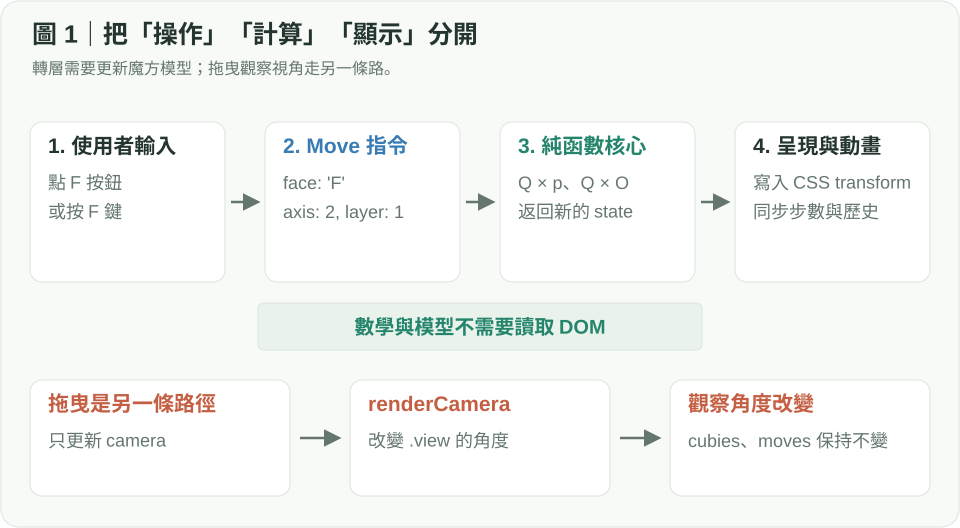

**看圖重點：**沿上排追一次 F 指令，它會經過資料計算再顯示。下排的拖曳直接改觀察角度，不經過轉層模型，所以不增加步數。

| 層次 | 負責的事情 | 對應程式 |
| --- | --- | --- |
| 資料模型 | 記錄每個小塊的位置、朝向、貼紙與轉動隊列 | `createCubie`、`createInitialState` |
| 純函數核心 | 計算旋轉、判斷復原、返回新的模型 | `rotateCubie`、`reduceState`、`isSolved` |
| 呈現與動畫 | 建立 DOM、輸出 CSS 矩陣、更新光影與控制台 | `mountCube`、`renderCubies`、`startNextMove` |
| 輸入處理 | 將按鈕、滑鼠、觸控與鍵盤操作轉為指令 | `requestTurn`、`handlePointerMove`、`handleKeyDown` |

整體旋轉視角只改變 `camera`，轉動某一層才改變魔方模型。因此，拖曳觀察角度不會增加步數，也不會影響復原判斷。

專案檔案與圖解放在同一個資料夾：

```text
common/
└── cube/
    ├── cube.html   # 完整、可獨立開啟的互動範例
    ├── cube.md     # 本篇設計解說
    └── images/    # 各節使用的本地 SVG 圖解
```

## 2. 用 27 個小塊建立資料模型

### 2.1 用整數表示位置

每一軸只需要三個位置：`-1`、`0`、`1`。

```text
x：左 -1 ／ 中 0 ／ 右 +1
y：下 -1 ／ 中 0 ／ 上 +1
z：後 -1 ／ 中 0 ／ 前 +1
```

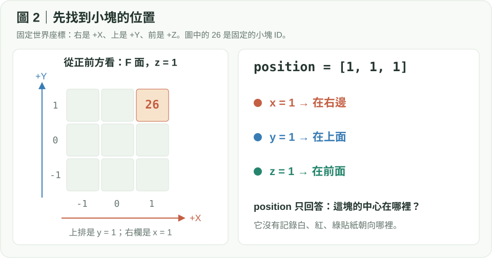

**看圖重點：**先把視線放在標示「26」的小塊。它在右欄、上排，而且屬於前面，所以中心座標是 `[1, 1, 1]`。這裡先只看位置，不必考慮貼紙。

三軸組合一共有 `3 × 3 × 3 = 27` 個小塊，包括完全藏在內部的核心塊。`createCubie(index)` 把 `0～26` 的索引轉換成座標：

```js
const position = [
  Math.floor(index / 9) - 1,
  (Math.floor(index / 3) % 3) - 1,
  (index % 3) - 1,
];
```

例如，索引 `26` 的座標是 `[1, 1, 1]`，位於右上前角。

### 2.2 用朝向矩陣記錄貼紙往哪裡

先記住一句話：**`position` 記錄小塊的中心在哪裡；`orientation` 記錄小塊自己的三支箭頭朝向哪裡。**

#### 第一步：在小塊上黏三支箭頭

想像每個小塊都有三支不會脫落的箭頭，分別叫局部 `+X`、`+Y`、`+Z`。小塊轉動，箭頭也一起轉。

整顆魔方另外有一套固定的世界軸：右是 `+X`、上是 `+Y`、前是 `+Z`。圖中的灰色虛線代表世界軸，彩色箭頭代表小塊自己的局部軸。

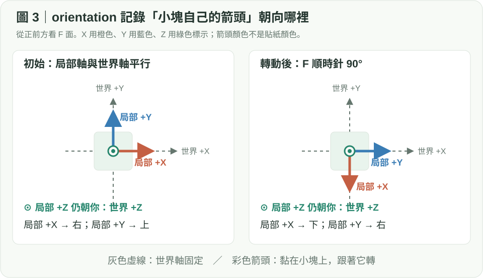

**看圖重點：**只盯著橙色的局部 X 箭頭。左圖它朝右，右圖它朝下；這個「現在朝下」的資訊，就是 `orientation` 要保存的內容之一。箭頭的顏色只為了區分 X、Y、Z，與貼紙顏色無關。

可以先把轉動後的 `orientation` 想成這張方向清單：

| 小塊自己的箭頭 | 現在指向世界的哪裡 |
| --- | --- |
| 局部 `+X` | 下，世界 `-Y` |
| 局部 `+Y` | 右，世界 `+X` |
| 局部 `+Z` | 前，世界 `+Z` |

#### 第二步：貼紙跟著箭頭走

這個例子使用 `id: 26` 的角塊。它原本的白色 U 貼紙位於局部 `+Y`，紅色 R 貼紙位於局部 `+X`，綠色 F 貼紙位於局部 `+Z`。

讓 F 面從外側看順時針轉 90°，三張貼紙就會跟著小塊改變朝向：

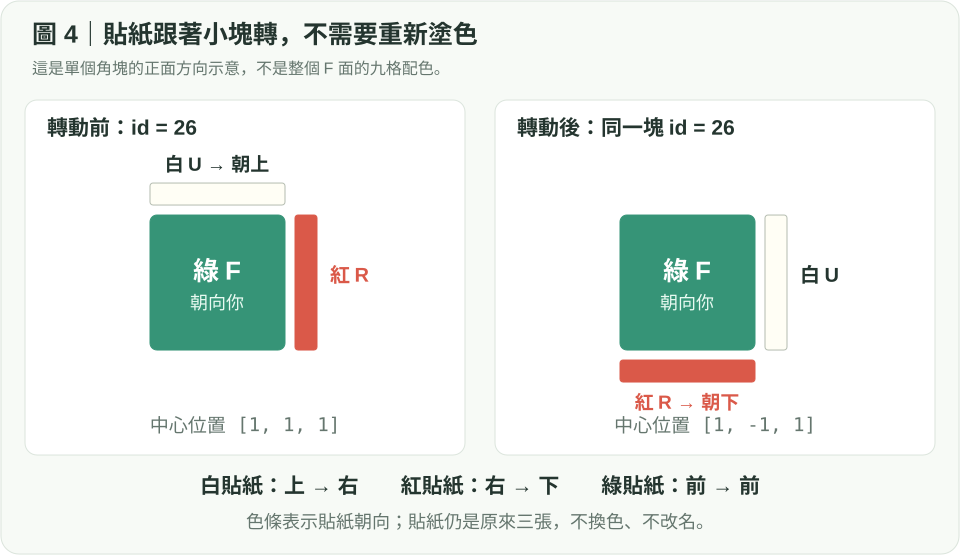

**看圖重點：**白色貼紙原本跟著局部 Y 朝上；轉完後，局部 Y 朝右，所以白色貼紙也朝右。程式沒有把白色改成紅色，也沒有把貼紙搬到另一個小塊。

同一次轉動發生兩件事：

- **位置變了：**小塊中心從右上前角 `[1, 1, 1]`，移到右下前角 `[1, -1, 1]`。
- **朝向變了：**白色轉向右、紅色轉向下；綠色仍然朝前。

#### 第三步：把方向清單寫成三個直欄

方向向量 `[x, y, z]` 可以看成三個分量。例如 `[0, -1, 0]` 表示 X、Z 方向都沒有分量，只有負 Y 分量，也就是朝下。

`orientation` 把三支箭頭的世界方向依序放進矩陣：**第一個直欄放局部 X、第二欄放局部 Y、第三欄放局部 Z。**

![圖 5：F 轉動後的朝向矩陣，三個直欄分別是局部 X、Y、Z 的世界方向；白色貼紙沿局部 Y，對應第二欄 [1,0,0]，表示朝右。](./images/05-matrix-columns.svg)

**看圖重點：**沿著藍色的第二個直欄，由上往下讀出 `[1, 0, 0]`。這就是局部 Y 的世界方向，也就是白色貼紙目前朝向的右方。

程式用三個陣列保存矩陣的三列，因此轉動後的資料寫成：

```js
const orientation = [
  [ 0, 1, 0],
  [-1, 0, 0],
  [ 0, 0, 1],
];
```

注意：**陣列是橫著存，但三支箭頭的方向要直著讀。**

| 讀取方式 | 取出的數字 | 意思 |
| --- | --- | --- |
| 第一欄：各列的第 1 個數字 | `[0, -1, 0]` | 局部 X 朝下 |
| 第二欄：各列的第 2 個數字 | `[1, 0, 0]` | 局部 Y 朝右 |
| 第三欄：各列的第 3 個數字 | `[0, 0, 1]` | 局部 Z 朝前 |

初始時三支箭頭都與世界軸平行，所以三個直欄依序是 `[1, 0, 0]`、`[0, 1, 0]`、`[0, 0, 1]`。把它們放在一起，就是程式的初始單位矩陣：

```js
const orientation = [
  [1, 0, 0],
  [0, 1, 0],
  [0, 0, 1],
];
```

#### 第四步：對照完整的小塊資料

理解圖解後，再看這個初始角塊的資料：

```js
{
  id: 26,                   // 固定識別碼，移動後也不改名
  position: [1, 1, 1],       // 中心位於右上前角
  orientation: [            // 三個局部軸目前都與世界軸平行
    [1, 0, 0],
    [0, 1, 0],
    [0, 0, 1],
  ],
  stickers: ['U', 'R', 'F'],  // 原本帶有白、紅、綠三張貼紙
}
```

轉動後 `id` 和 `stickers` 保持原值；更新的是 `position` 和 `orientation`。`stickers` 保存貼紙原本在小塊上的面名，並不表示它們現在仍在世界的 U、R、F 面。

程式以這個公式取得貼紙現在的方向：

```text
貼紙的世界方向 = orientation × 貼紙的局部方向
```

以白色貼紙為例，其局部方向是 `[0, 1, 0]`。乘上這個向量，等於「第一欄取 0 份、第二欄取 1 份、第三欄取 0 份」，所以結果就是圖 5 的第二欄 `[1, 0, 0]`。

可以在開啟範例的開發者工具 Console 中驗證。這段只建立範例資料，不改變畫面：

```js
{
  const rotated = rotateCubie(createCubie(26), createMove('F'));
  console.log(rotated.position); // [1, -1, 1]
  console.log(rotated.orientation); // [[0, 1, 0], [-1, 0, 0], [0, 0, 1]]
  console.log(transformVector(rotated.orientation, FACES.U.normal)); // [1, 0, 0]
}
```

`orientation` 保存從初始狀態累積到現在的朝向。之後再轉其他面，會以 `新朝向 = 本次旋轉矩陣 × 舊朝向` 更新；第 5 節會接著說明矩陣相乘。

也可以觀察 F 面中心塊：轉 F 面時，它的中心始終在 `[0, 0, 1]`，但局部 X、Y 箭頭仍會轉動。因此，即使 `position` 沒變，`orientation` 仍可能改變。

### 2.3 為何外部只有 54 張貼紙

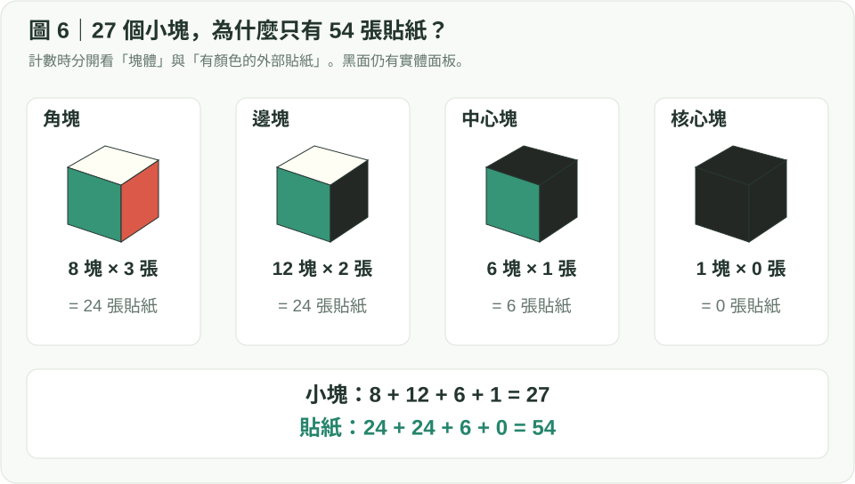

**看圖重點：**先數小塊，再乘上每塊的貼紙數。核心雖然看不見，仍是 27 塊之一；黑色面板則不算彩色貼紙。

只有位於某個外側平面的小塊，才在對應面上建立貼紙：

```js
// 以 U 面為例：只有 y = 1 的小塊具有白色貼紙。
position[FACES.U.axis] === FACES.U.layer;
```

每個外面有九張貼紙，總數為 `6 × 9 = 54`。角塊有三張、邊塊有兩張、中心塊有一張，核心塊沒有貼紙。

## 3. 固定面名、顏色與座標方向

程式以 `FACES` 集中定義六面，避免渲染、轉動與點擊判斷各自使用不同規則。

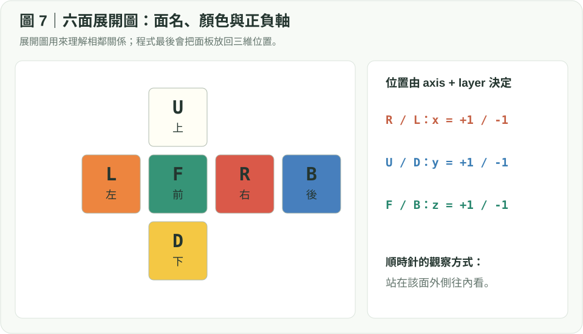

**看圖重點：**以綠色 F 為中心找相鄰面。R 與 L 使用同一條 X 軸，但 layer 正負不同；U／D 與 F／B 也同理。下表再把圖中的關係寫成資料。

| 面 | 位置 | 顏色 | `axis` | `layer` | 局部法線 |
| --- | --- | --- | --- | --- | --- |
| U，上 | `y = 1` | 白 | 1 | 1 | `[0, 1, 0]` |
| D，下 | `y = -1` | 黃 | 1 | -1 | `[0, -1, 0]` |
| L，左 | `x = -1` | 橙 | 0 | -1 | `[-1, 0, 0]` |
| R，右 | `x = 1` | 紅 | 0 | 1 | `[1, 0, 0]` |
| F，前 | `z = 1` | 綠 | 2 | 1 | `[0, 0, 1]` |
| B，後 | `z = -1` | 藍 | 2 | -1 | `[0, 0, -1]` |

法線是垂直於表面、指向外側的方向向量。本例中的法線都是單位向量，既能用來判斷貼紙目前面向哪裡，也能用來計算光照。

「順時針」一律從該面的外側看向魔方定義，與目前相機看到的角度無關。

## 4. 用 CSS 平面組出立方體

### 4.1 DOM 的每一層都有特定用途

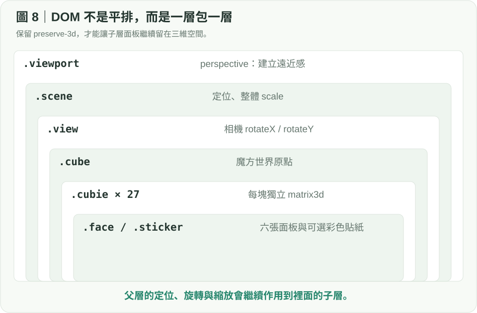

**看圖重點：**由外往內讀：view 旋轉會帶動整顆魔方；cubie 的矩陣只控制單一小塊。把兩種 transform 放在不同層，就能獨立改視角和轉層。

```text
.viewport           透視投影、接收指標事件
└── .scene          舞台中央位置與整體縮放
    └── .view       觀察視角 rotateX / rotateY
        └── .cube   所有小塊的共同原點
            └── .cubie × 27
                └── .face × 6
                    └── .sticker（只有外側面才建立）
```

`.viewport` 設定 `perspective: 1400px`。`.scene`、`.view`、`.cube` 和 `.cubie` 保留 `transform-style: preserve-3d`，讓小塊及其面板繼續存在於三維空間。

每個小塊有六張黑色面板，所以總共有 162 張 `.face`。轉層露出的內部切面因此仍有黑色塊體，不會只剩漂浮的彩色貼紙。

### 4.2 把六張面板放到小塊四周

小塊邊長是 `79px`，半邊長為 `39.5px`。面板從初始朝向螢幕外的平面出發，旋轉後再移到外側：

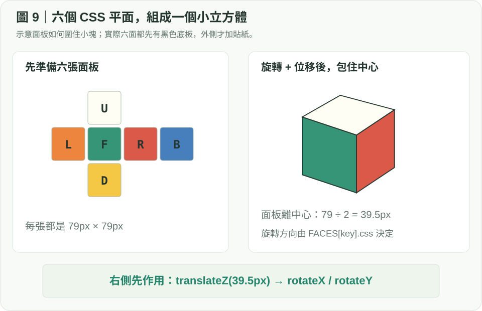

**看圖重點：**先看左邊六張面板，再看右邊組裝結果。每面離中心半個邊長；transform 字串從右往左作用，先移出 39.5px，再旋到對應方向。

| 面板 | 局部 CSS transform |
| --- | --- |
| F | `rotateY(0deg) translateZ(39.5px)` |
| B | `rotateY(180deg) translateZ(39.5px)` |
| R | `rotateY(90deg) translateZ(39.5px)` |
| L | `rotateY(-90deg) translateZ(39.5px)` |
| U | `rotateX(90deg) translateZ(39.5px)` |
| D | `rotateX(-90deg) translateZ(39.5px)` |

理解這些 transform 時，依右側到左側的作用順序閱讀：先沿局部 Z 軸移動，再旋轉到對應方向。

`.cubie` 的 `left`、`top` 都設為 `-39.5px`，讓小塊中心落在父層的零點。如此一來，CSS 預設的中心旋轉原點就能與模型中的小塊中心對齊。

### 4.3 用間距與分層樣式建立材質

相鄰小塊的中心間距 `PITCH` 是 `83px`，大於邊長 `79px`，所以塊體之間留下約 `4px` 的縫隙。

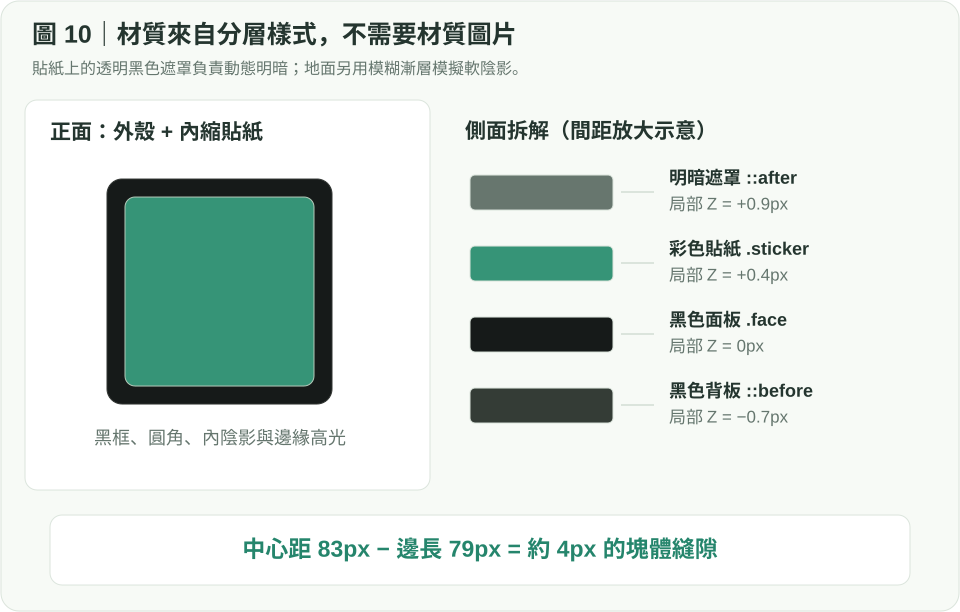

**看圖重點：**右邊把很小的 Z 間距放大。貼紙上方還有透明黑色遮罩，更新它的 opacity 就能改明暗，不必改動貼紙原色。底下的 4px 則是相鄰塊體間的幾何縫隙。

質感由幾種效果共同構成：

- `.face` 的深色底、圓角、邊框與內陰影，建立黑色塑膠外殼與邊緣高光。
- `.face::before` 放在面板稍後方，補上圓角附近的黑色背板。
- `.sticker` 使用內縮、圓角、漸層與陰影，產生貼在外殼上的厚度感。
- `.face::after` 置於貼紙上方，以透明黑色遮罩表現動態明暗。
- `.shadow` 使用徑向漸層與模糊，形成舞台上的柔和接觸陰影。

地面陰影是固定的視覺近似；隨面朝向更新的是面板光照，沒有進行光線追蹤或實體投影陰影計算。

## 5. 用純函數計算一次轉層

### 5.1 先把操作轉成資料

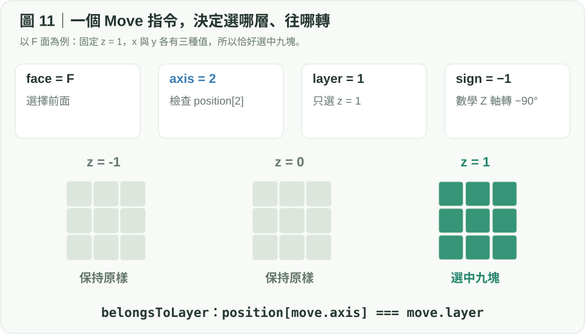

**看圖重點：**三層都有九塊，但只有 z = 1 的前層符合條件。axis 決定檢查 position 的哪一格，layer 決定那一格要等於多少；sign 不參與選取。

`createMove('F')` 會產生一個包含以下資訊的指令：

```js
{
  face: 'F',
  axis: 2,
  layer: 1,
  sign: -1,
  inverse: false,
  source: 'manual',
}
```

`axis` 和 `layer` 決定選取哪九塊，`sign` 決定繞數學座標正軸旋轉的正負方向。轉動角度為 `sign × 90°`。

順時針指令的符號為 `-layer`；反向時再乘以 `-1`。這同時處理正軸面與負軸面從外側觀看時的方向差異。

### 5.2 用矩陣同時改變位置與朝向

![圖 12：F 順時針的旋轉矩陣乘上位置 [1,1,1] 得到 [1,-1,1]；同一矩陣也左乘朝向。](./images/12-matrix-step.svg)

**看圖重點：**一列算出一個輸出分量。第一列取出舊 y，第二列取負的舊 x，第三列保留 z，因此整個規則是 [x, y, z] → [y, -x, z]。對朝向矩陣的每一欄也做同樣運算。

令 `s` 為 `+1` 或 `-1`，四分之一圈的旋轉矩陣如下：

```text
Rx = [ 1  0   0 ]   Ry = [ 0  0  s ]   Rz = [ 0 -s  0 ]
     [ 0  0  -s ]        [ 0  1  0 ]        [ s  0  0 ]
     [ 0  s   0 ]        [-s  0  0 ]        [ 0  0  1 ]
```

`quarterMatrix(axis, sign)` 返回對應矩陣 `Q`，`rotateCubie` 接著計算：

```text
新位置 p′ = Q × p
新朝向 O′ = Q × O
```

朝向矩陣要左乘，因為這次轉動發生在魔方的世界座標軸上。

例如，F 面順時針對應繞 Z 軸 `-90°`：

```text
原位置 [1, 0, 1] → 新位置 [0, -1, 1]
```

也就是前面的右側邊塊移到下側。

模型只儲存轉動完成後的整數結果。任意角度的三角函數只用於動畫中的照明，因此重複轉動不會讓位置逐漸偏離格點。

## 6. 正確轉換數學座標與 CSS 座標

先看兩套座標的箭頭，會發現只有 Y 的正方向相反：

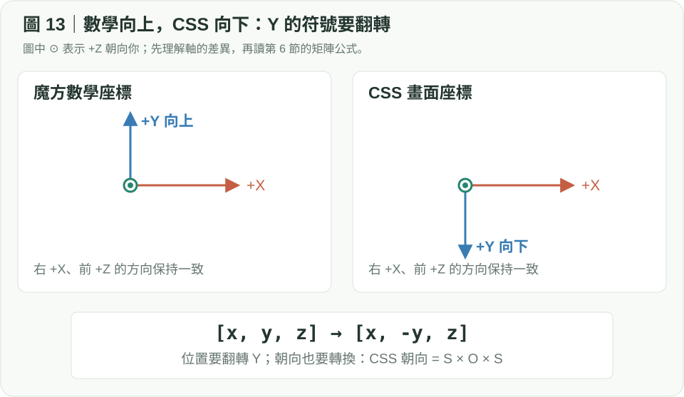

**看圖重點：**同一個「往上」的位置，在數學模型使用正 Y，在 CSS 畫面則需要負 Y。因此，位置和朝向都要轉換。

模型的 `+Y` 向上，CSS 畫面的 `+Y` 向下。轉換矩陣為：

```text
S = [1  0  0]
    [0 -1  0]
    [0  0  1]
```

位置與朝向都必須轉換：

```text
CSS 位置 = PITCH × S × p
CSS 朝向 = S × O × S
```

只將位置的 Y 值取負，卻直接使用原始朝向矩陣，會造成貼紙旋轉方向錯誤。`cubieTransform` 同時完成這兩件事，再把 3×3 朝向與平移資料包成 CSS `matrix3d`。

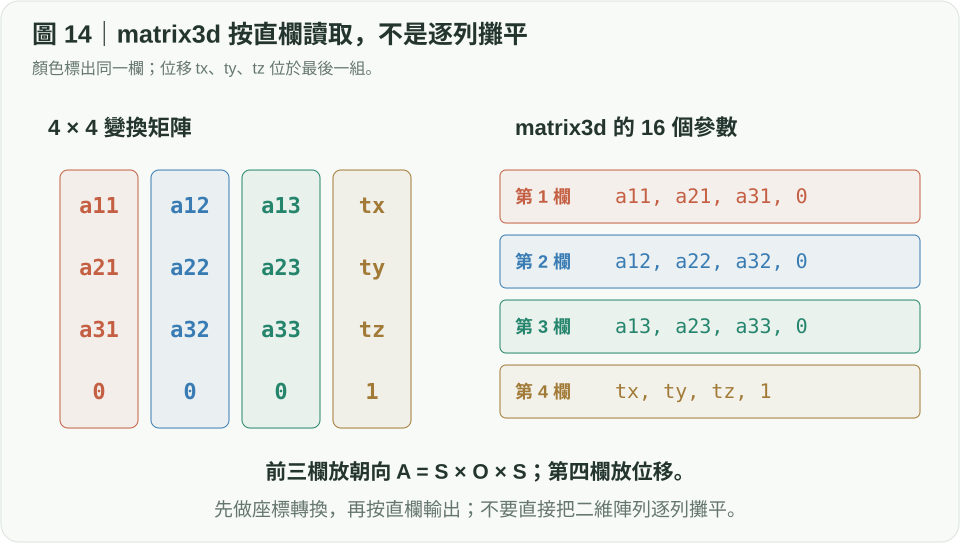

**看圖重點：**沿橙、藍、綠三欄依序往下讀，再接最後的平移欄。座標轉換 S × O × S 要先完成；按欄輸出只是把結果交給 CSS 的格式規則。

`matrix3d` 的參數依欄排列，與程式用二維陣列儲存的列順序不同：

```text
matrix3d(
  a11, a21, a31, 0,
  a12, a22, a32, 0,
  a13, a23, a33, 0,
  tx,  ty,  tz,  1
)
```

其中 `A = S × O × S`，`[tx, ty, tz] = PITCH × S × p`。

## 7. 讓九個小塊一起沿圓弧旋轉

### 7.1 給九塊共同的外層旋轉

先觀察整層的起點、中途與終點。標示「26」的始終是同一塊：

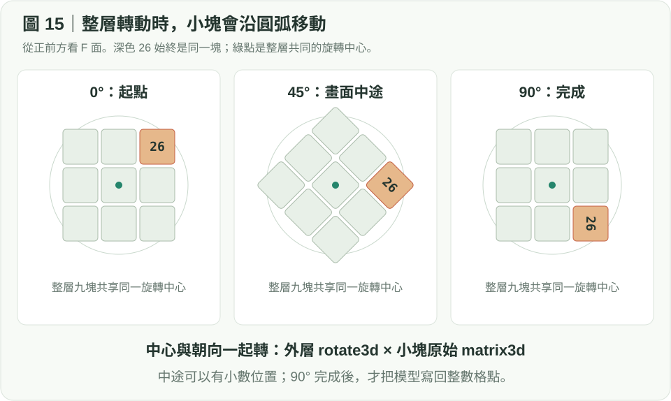

**看圖重點：**中間的 45° 畫面中，不只每塊自己的朝向改了，小塊中心也繞著綠點移動。因此，動畫必須同時旋轉位置與朝向。

動畫期間，模型仍保留上一步完成後的整數狀態。選中的九個 DOM 元素都使用相同形式的 transform：

```css
/* 起點 */
transform: rotate3d(ax, ay, az, 0deg) matrix3d(/* 小塊原本的矩陣 */);

/* 終點：角度依指令決定正負 */
transform: rotate3d(ax, ay, az, 90deg) matrix3d(/* 同一個原始矩陣 */);
```

外層 `rotate3d` 同時旋轉原始矩陣中的位置與朝向。小塊因此繞共同的魔方原點走圓弧，而不是只繞各自中心自轉。

前後 transform 保留相同的函數列表，且 `matrix3d` 內容相同，讓瀏覽器插值主要落在共同的旋轉角度上。

Y 軸轉換屬於鏡射，會改變座標系的手性。若數學旋轉軸是 `a`、角度是 `θ`，`rotationPrefix` 使用的 CSS 軸與角度為：

```text
CSS 軸   = S × a
CSS 角度 = -θ
```

這讓動畫終點和 `cubieTransform(rotateCubie(...))` 得到相同的空間變換。

### 7.2 把動畫開始與模型提交分開

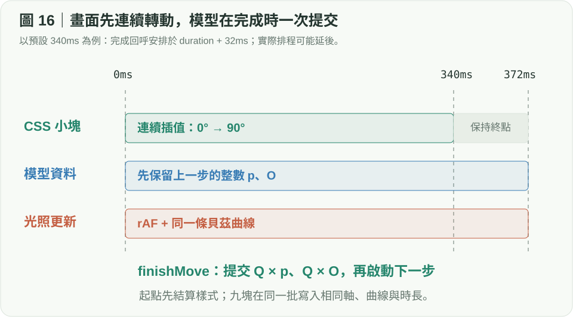

**看圖重點：**對齊三條時間軸看：CSS 已經到終點時，模型仍可能暫時保留舊值。finishMove 才統一提交九塊的 p、O 並開始下一步；這避免每幀把小數寫回模型。

`startNextMove` 依序完成：

1. 取出隊首指令，選出當層九塊。
2. 關閉過渡，寫入 `rotate3d(..., 0deg) + 原始矩陣`。
3. 讀取一次 `offsetWidth`，讓瀏覽器結算起點樣式。
4. 同步為九塊設定相同的過渡時長、曲線與旋轉終點。
5. 啟動光照更新，並安排完成回呼。

過渡曲線是 `cubic-bezier(.4,0,.2,1)`，預設時長為 `340ms`。滑桿範圍是 `160～600ms`；使用者偏好減少動態效果時，轉層縮短為 `100ms`。

目前使用 `duration + 32ms` 的計時器呼叫 `finishMove`。完成後才用精確整數矩陣更新模型、關閉過渡、寫回小塊 transform，接著執行下一步。

## 8. 以 reducer 管理不可變狀態

魔方模型包含：

```js
{
  cubies: [],    // 27 個小塊
  moves: 0,      // 已完成的轉動數
  history: [],   // 最近 18 步記號
  queue: [],     // 尚未開始的指令
  current: null, // 正在執行的指令
}
```

`reduceState(previous, action)` 是純函數。相同的輸入會得到相同的輸出，而且不修改舊狀態：

| Action | 返回的新狀態 |
| --- | --- |
| `QUEUE` | 把新指令追加到隊列 |
| `START` | 將隊首移到 `current` |
| `FINISH` | 更新小塊、步數與歷史，清空 `current` |
| `RESET` | 返回全新的初始狀態 |

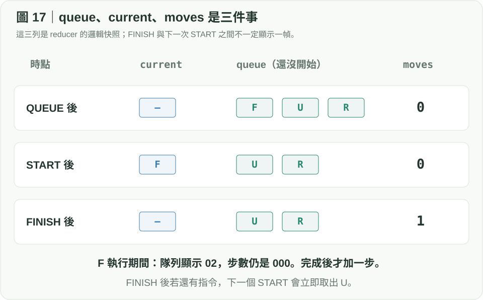

**看圖重點：**START 把 F 從 queue 移到 current，queue 從三步變兩步，但 moves 還是 0。F 完成後 moves 才變 1。圖中三列是邏輯快照，不代表每列都會停留一幀。

函數式設計集中在資料與數學核心。DOM 操作、計時器、事件監聽及 `state` 變數的重新指定仍屬於副作用，由外層函數負責。

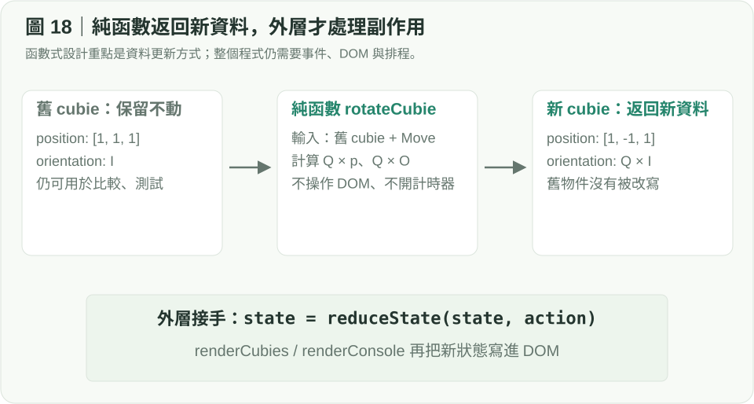

**看圖重點：**左邊舊物件仍保持原值，右邊是新物件。純函數只計算資料，DOM、計時器和 state 的重新指定留給外層，測試時就能把兩者分開。

例如，`rotateCubie` 返回新小塊，`renderCubies` 才把結果寫進樣式。需要測試轉動正確性時，可以直接測試前者，無須建立 DOM。

打亂函數也遵守相同分工：`createScramble(random)` 接收亂數函數，真正的 `Math.random` 由外層 `scrambleCube` 傳入。測試時可以替換為可預期的亂數來源。

## 9. 讓光影跟著面朝向改變

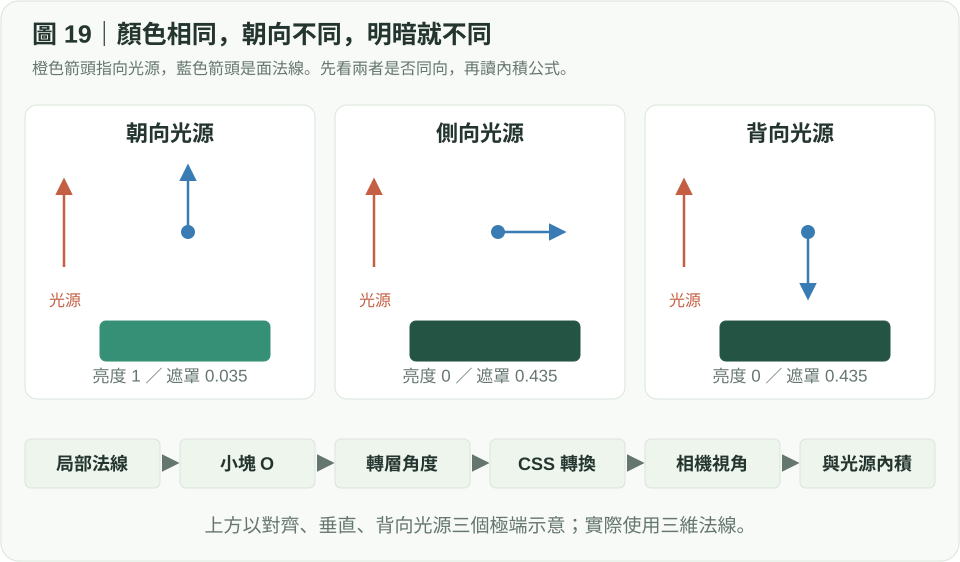

**看圖重點：**先比較藍色法線與橙色光源方向：越同向，遮罩越淡；側向或背向就較暗。這是方向計算，不是把某種貼紙顏色固定設為較暗。下排箭頭對應 renderLighting 的計算順序。

`renderLighting` 不根據顏色決定亮暗，而是為全部 162 張面板計算法線。

計算流程為：

```text
局部面法線
  → 乘上小塊朝向 O
  → 若正在轉層，再乘上目前動畫旋轉
  → 轉換為 CSS 座標
  → 乘上相機視角旋轉
  → 與固定光源方向計算內積
  → 寫入 --shade
```

本例的光源方向近似 `[-0.38, -0.62, 0.686]`。面越朝向光源，內積越大，遮罩透明度就越低：

```text
brightness = max(0, dot(screenNormal, lightDirection))
shade = 0.035 + (1 - brightness) × 0.40
```

CSS 負責插值小塊的位置，`requestAnimationFrame` 負責更新光照。為了讓兩者同步，`easedProgress` 以二分搜尋求出同一條貝茲曲線的進度，而不是直接使用線性的經過時間。

相機使用 `rotateX(...) rotateY(...)`，所以計算法線時也依相同的作用順序，先套 Y 軸旋轉，再套 X 軸旋轉。

## 10. 分清楚點擊與拖曳

### 10.1 按下時記錄起點，不立即轉層

`handlePointerDown` 記錄指標 ID、按下座標、當時的相機、命中的貼紙與動畫版本。

接著使用 Pointer Capture，即使指標離開原本命中的貼紙，舞台仍能繼續收到移動與放開事件。`touch-action: none` 則讓舞台內的觸控拖曳交由程式處理。

### 10.2 使用相對按下點的累計位移

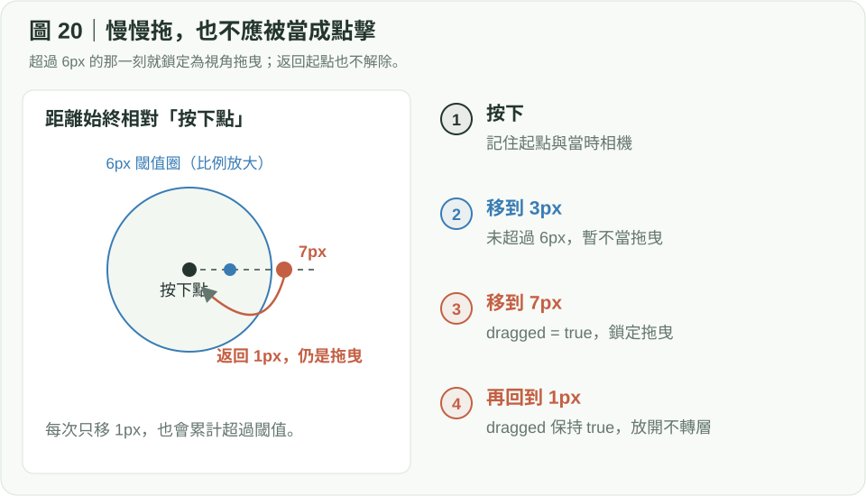

**看圖重點：**圓心是按下點，不是上一個 pointermove 的位置。從 3px 慢慢移到 7px 仍會越界；越界後只轉視角，放開時也不再當點擊。

`handlePointerMove` 每次計算的都是：

```text
dx = 目前 clientX - 按下時 clientX
dy = 目前 clientY - 按下時 clientY
distance = hypot(dx, dy)
```

距離超過 `6px` 就將 `dragged` 鎖定為 `true`。這個值在同一手勢內不會再恢復為 `false`，即使拖回起點也不會觸發貼紙點擊。

慢慢拖曳時，每個事件可能只移動 `1px`，但相對起點的距離仍會持續增加，因此能正確辨識拖曳。

相機角度以「按下時的角度 + 總位移」計算，X 軸限制在 `-85°～85°`；不改變小塊的數學狀態。

### 10.3 點擊時判斷貼紙目前所在的面

以 R 面順時針轉動為例：一張原本屬於 F 的綠色貼紙，會出現在 U 面。此時點它，應轉 U 面。

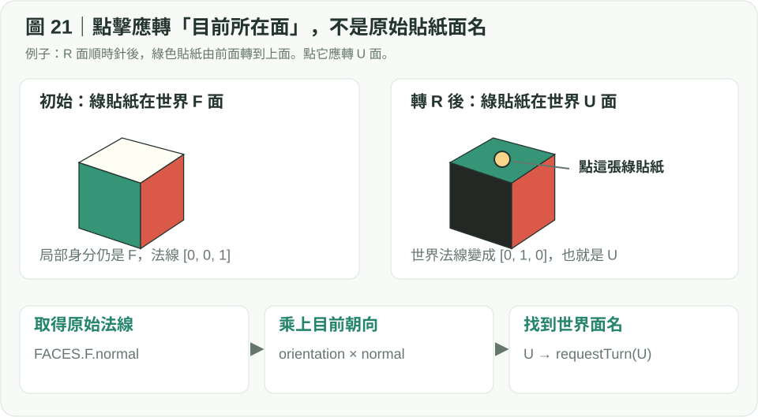

**看圖重點：**右圖點到的綠貼紙，原始身分仍是 F，但世界法線已是 [0, 1, 0]。因此不能直接拿 data-local-face 當轉層面名，要先經過 faceAtSticker。

`faceAtSticker` 使用：

```text
目前世界法線 = 小塊朝向 O × 貼紙原始法線
```

再與 `FACES` 中的六個方向比較，取得目前面名。

`handlePointerUp` 只有在未拖曳、命中貼紙、目前沒有動畫，而且按下至放開期間動畫版本未改變時，才送出轉動指令。動畫期間的貼紙輕點會忽略，按鈕與鍵盤則可繼續排隊。

## 11. 打亂、復原與復原判斷

### 11.1 打亂產生合法指令

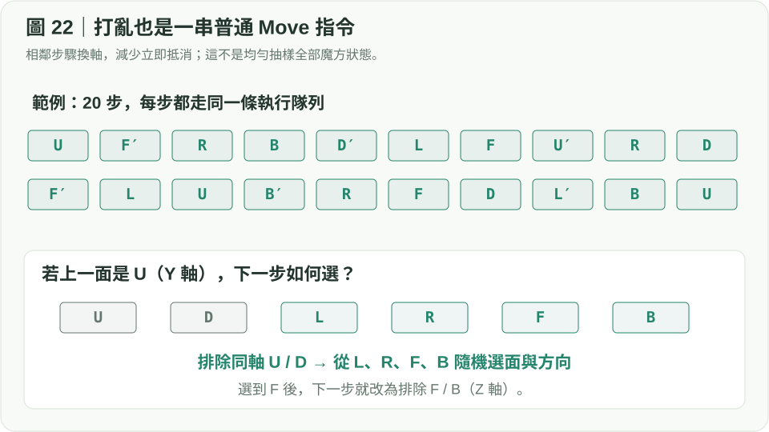

**看圖重點：**看下排的候選面：排除的是整條軸，不只排除剛轉過的 U。每次選完一面，就用它的軸建立下一步候選；選好的指令仍交給普通隊列執行。

`createScramble` 遞迴累積 20 步，每步隨機選面與方向，相鄰步驟使用不同軸，避免緊接著同軸轉動。

打亂與手動轉動使用同一條隊列，也會增加步數並記入歷史。再次按打亂會追加 20 步，不會自動清空已存在的操作。這是互動示範用的隨機序列，沒有提供均勻抽樣所有魔方狀態的保證。

### 11.2 復原必須讓舊回呼失效

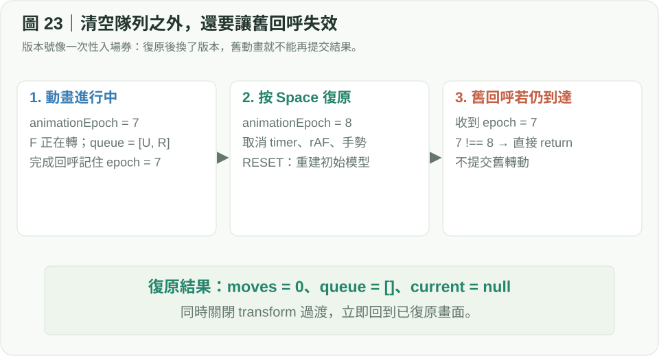

**看圖重點：**按復原不只是把色塊放回去。已排程的舊回呼也可能晚到，因此同時取消 timer、rAF，並檢查 epoch，才能防止稍後又轉出舊的一步。

`resetCube` 同時處理模型與執行中的副作用：

1. 增加 `animationEpoch`，使舊動畫版本失效。
2. 清除完成計時器與光照動畫幀。
3. 清除動畫與手勢資訊。
4. 透過 `RESET` 清空隊列、步數、歷史，重建已復原模型。
5. 關閉小塊過渡，立即繪製復原結果。

`finishMove(epoch)` 會先檢查版本。即使舊回呼已進入待執行狀態，也不能把過期轉動提交到新模型。

這個「瞬時復原」會重設狀態，沒有搜尋解法或播放還原步驟。觀察視角、節奏與反向開關則維持原設定；重設視角有獨立按鈕。

### 11.3 用貼紙方向判斷是否完成

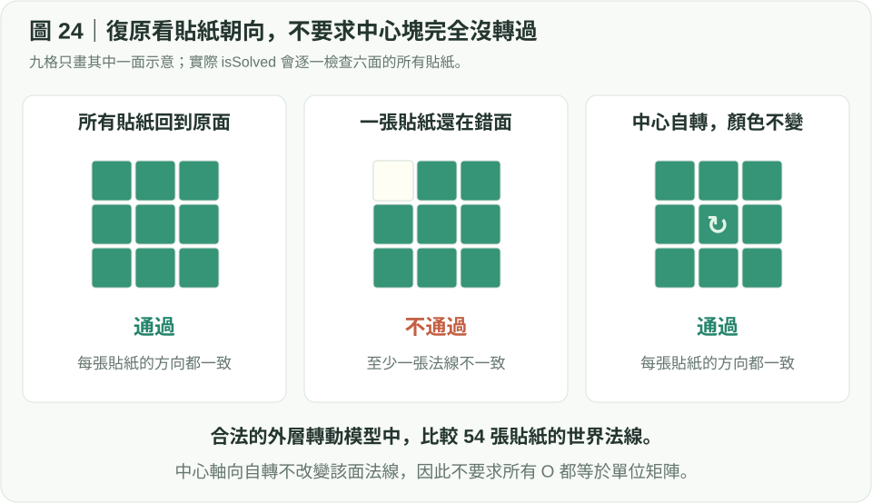

**看圖重點：**比較左圖與中圖：只要還有一張貼紙朝錯面，就未完成。右圖的中心自轉沒有改變其表面朝向，所以不能用「所有 orientation 都是單位矩陣」當復原條件。

`isSolved` 檢查每張貼紙的目前世界法線，是否和原本所屬面的法線一致。

本例只允許固定中心的外層轉動，因此對合法模型而言，所有貼紙都回到原本朝向，就代表六面顏色復原。此判斷不要求中心塊的朝向矩陣完全等於單位矩陣，也不檢查裝飾字樣的旋轉角度。

## 12. 控制台與快捷鍵

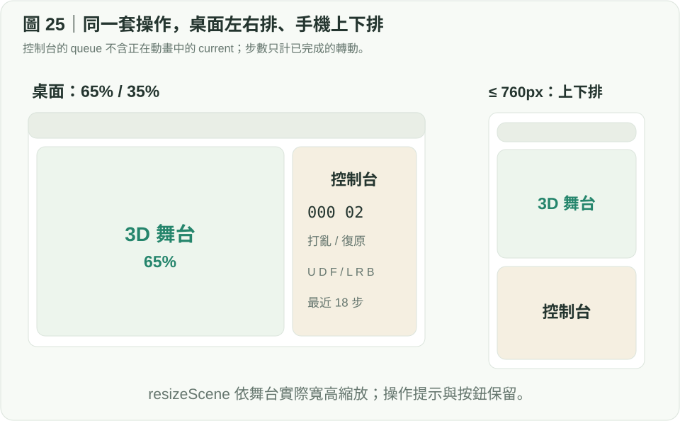

**看圖重點：**桌面與手機使用同一份 DOM 與狀態，只更換排版。縮放依舞台可用尺寸計算；控制台裡的步數、隊列與操作按鈕不需要各寫一套手機邏輯。

桌面版以 CSS Grid 分成左側 65% 舞台與右側 35% 控制台；寬度不超過 `760px` 時改為上下排列。`resizeScene` 配合 `ResizeObserver`，依舞台寬高調整魔方比例。

控制台顯示已完成步數、尚未開始的隊列長度、狀態徽章與最近 18 步歷史。正在動畫中的一步放在 `current`，不包含在隊列數中，也要完成後才增加步數。

| 操作 | 結果 |
| --- | --- |
| 拖曳舞台 | 旋轉觀察視角 |
| 輕點貼紙 | 轉動貼紙目前所在的面 |
| 六面按鈕 | 轉動指定面 |
| `↑`／`↓`／`←`／`→` | 依序轉動 U／D／L／R |
| `U`／`D`／`L`／`F`／`B` | 轉動對應面，不區分大小寫 |
| 按住 `Shift` | 使用反向轉動 |
| 反向旋轉開關 | 持續使用反向模式，適合觸屏 |
| `R` 或隨機打亂按鈕 | 加入 20 步打亂；R 面使用右方向鍵 |
| `Space` 或瞬時復原按鈕 | 中斷整個隊列並立即復原 |
| 重設視角按鈕 | 恢復預設觀察角度，保留魔方進度 |

反向開關與 Shift 採「任一啟用就反向」的規則，同時開啟不會互相抵消。鍵盤事件也會略過輸入元件、瀏覽器組合鍵與長按重複觸發，減少操作衝突。

## 13. 沿著初始化流程閱讀程式

可以從檔案底部的 `initialize` 開始追蹤：

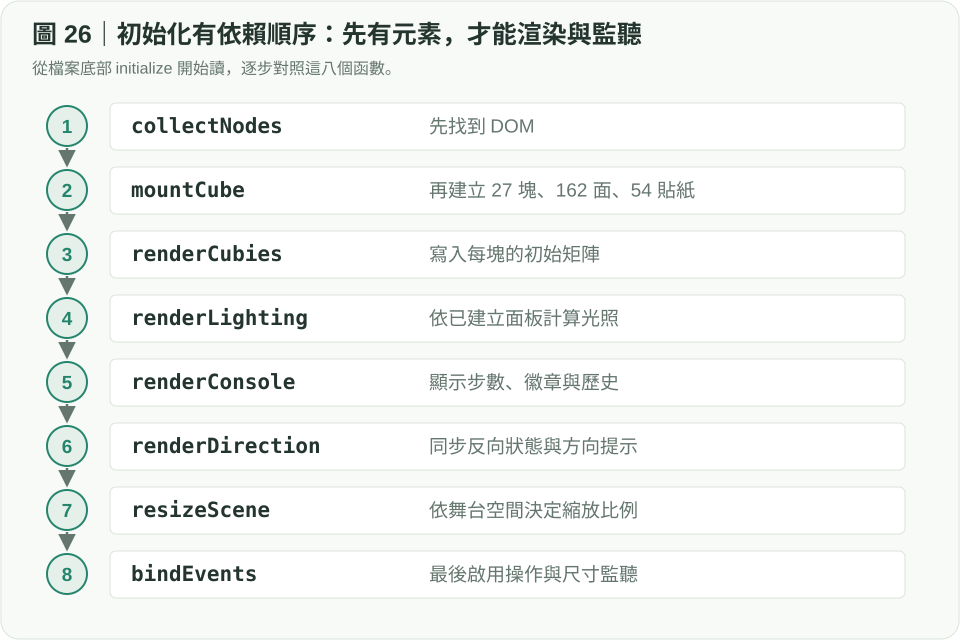

**看圖重點：**跟著 1 到 8 往下看。mountCube 要先於 renderCubies，因為必須先有小塊 DOM 才能寫樣式；最後 bindEvents 才讓使用者進入完整可操作的場景。

| 順序 | 函數 | 為什麼在這一步執行 |
| --- | --- | --- |
| 1 | `collectNodes` | 先取得渲染與事件處理需要的 DOM |
| 2 | `mountCube` | 建立小塊、面板與貼紙，保存元素索引 |
| 3 | `renderCubies` | 依模型寫入初始位置與朝向 |
| 4 | `renderLighting` | 為已建立的面板設定初始光照 |
| 5 | `renderConsole` | 顯示初始狀態、步數與歷史 |
| 6 | `renderDirection` | 顯示目前的旋轉方向 |
| 7 | `resizeScene` | 根據舞台可用空間決定縮放 |
| 8 | `bindEvents` | 啟用各種輸入及尺寸變化監聽 |

要理解一次轉動，再沿著 `requestTurn → enqueueMoves → startNextMove → finishMove` 閱讀，並在提交模型時查看 `reduceState` 和 `rotateCubie`。

其餘重要函數可依問題查找：

| 想理解的問題 | 閱讀函數 |
| --- | --- |
| 向量與矩陣如何運算 | `dot`、`transformVector`、`multiplyMatrices` |
| 四分之一圈如何保持整數 | `quarterMatrix` |
| 動畫中任意角度如何計算 | `continuousMatrix` |
| CSS 位置和旋轉如何對齊 | `cubieTransform`、`rotationPrefix` |
| 光照如何跟上動畫曲線 | `faceShade`、`easedProgress`、`currentAnimationProgress`、`tickLighting` |
| 點擊如何與拖曳分開 | `handlePointerDown`、`handlePointerMove`、`handlePointerUp` |
| 取消操作如何清理 | `cancelGesture`、`handleBlur`、`resetCube` |
| UI 如何反映模型 | `renderConsole`、`renderHistory`、`renderDirection` |

## 14. 驗證設計是否正確

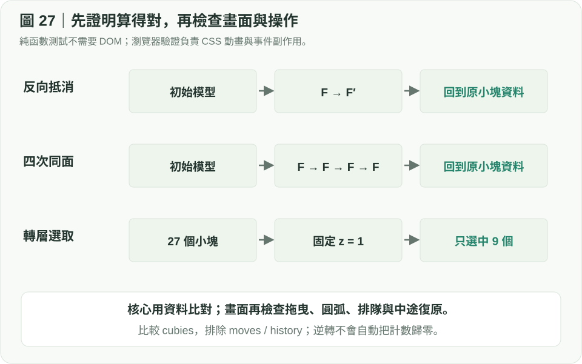

**看圖重點：**前三列都能直接比較資料，不需要畫出魔方。若這些都通過但畫面還會撕裂或誤點，就接著檢查 CSS、事件與計時器，而不是先重寫矩陣。

### 14.1 先驗證不需要 DOM 的核心

在開啟範例的瀏覽器開發者工具 Console 中，可以執行以下程式。它只建立局部測試資料，不改變畫面上的 `state`：

```js
{
  const initial = createInitialState();

  /** 在局部模型上提交一步，方便驗證純函數核心。 */
  const applyMove = (model, move) =>
    reduceState({ ...model, current: move }, { type: 'FINISH' });

  /** 將小塊資料序列化，排除步數與歷史對比較結果的影響。 */
  const snapshot = (model) => JSON.stringify(model.cubies);

  /** 逐面驗證反向抵消、四次轉動還原，以及單次轉層選取數量。 */
  FACE_KEYS.forEach((face) => {
    const move = createMove(face);
    const inverse = createMove(face, true);
    const restored = applyMove(applyMove(initial, move), inverse);
    console.assert(snapshot(restored) === snapshot(initial), face + ' 正反抵消');

    const fourTurns = Array.from({ length: 4 }).reduce(
      /** 重複提交同一個面向的四分之一圈轉動。 */
      (model) => applyMove(model, move),
      initial,
    );
    console.assert(snapshot(fourTurns) === snapshot(initial), face + ' 四轉還原');

    const selected = initial.cubies.filter(
      /** 只計入屬於本次轉層的小塊。 */
      (cubie) => belongsToLayer(cubie, move),
    );
    console.assert(selected.length === 9, face + ' 選中九塊');
  });
}
```

還可以將一組打亂指令倒序，並逐步反轉 `inverse` 執行；結果應回到原始小塊資料。比較時應排除步數與歷史，因為這些紀錄不會隨逆轉自動歸零。

### 14.2 再驗證畫面與輸入

| 驗證項目 | 預期結果 |
| --- | --- |
| DOM 數量 | 27 個 `.cubie`、162 個 `.face`、54 個 `.sticker` |
| 轉層中途 | 九塊維持共同旋轉，沿圓弧移動，非直線換位 |
| 動畫終點 | `rotate3d + 舊矩陣` 等於精確轉動後的新矩陣 |
| 慢速拖曳超過 6px | 只改視角，不增加步數 |
| 拖曳後返回按下點 | 仍算拖曳，不觸發貼紙點擊 |
| 轉動後點同一張貼紙 | 依目前所在面轉層 |
| 快速按多個轉層鍵 | 按順序執行，不同時啟動多層動畫 |
| 打亂中按空格 | 隊列與計時器失效，立即復原，稍後不再跳動 |
| 縮小視窗與觸屏操作 | 無水平溢位，控制台可捲動到達，輕點與拖曳正常 |

CSS 同構可用 `DOMMatrix` 比較：將 `rotationPrefix(move, 1) + cubieTransform(cubie)` 與 `cubieTransform(rotateCubie(cubie, move))` 轉成矩陣，逐項比較並容許微小浮點誤差。

## 15. 建議的實作順序與排錯方向

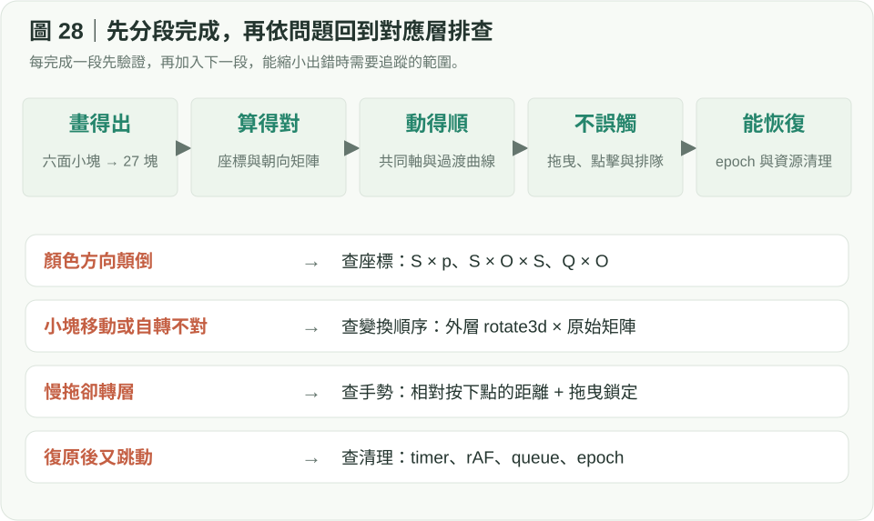

**看圖重點：**上排是實作順序，下排是排錯入口。例如「復原後又跳動」先看排程清理與 epoch；「顏色方向顛倒」則先查座標轉換與矩陣乘法。

自行重做時，先完成一個六面小塊，再擴充為 27 塊；接著建立模型與精確轉動，確認正反抵消及四轉還原，才加入過渡動畫。最後接上照明、拖曳、隊列、復原與控制台。

| 現象 | 優先檢查 |
| --- | --- |
| 白色跑到下方、方向顛倒 | 位置是否使用 `S × p`，朝向是否使用 `S × O × S` |
| 小塊只在自己的位置自轉 | 外層旋轉是否放在原始小塊矩陣左側 |
| 九塊移動不同步 | transform 列表、軸、時長、曲線及寫入時機是否一致 |
| 轉動後貼紙朝向錯誤 | 是否同時更新位置與朝向，且使用 `Q × O` |
| 完成動畫時突然跳一下 | CSS 動畫終點是否與精確矩陣同構 |
| 慢拖放開卻觸發轉層 | 閾值是否相對按下點計算，拖曳狀態是否持續鎖定 |
| 復原後又發生舊轉動 | 計時器、動畫幀與 `animationEpoch` 是否一併處理 |
| 光影與位置旋轉不同步 | 照明是否使用相同的貝茲進度與相機矩陣順序 |

本例最值得保留的設計原則是：以整數模型保存完成狀態，以連續變換呈現過渡過程，再由單一隊列串接所有輸入。理解這三者的邊界後，就能逐步加入撤銷、重播或新的觀察工具。
